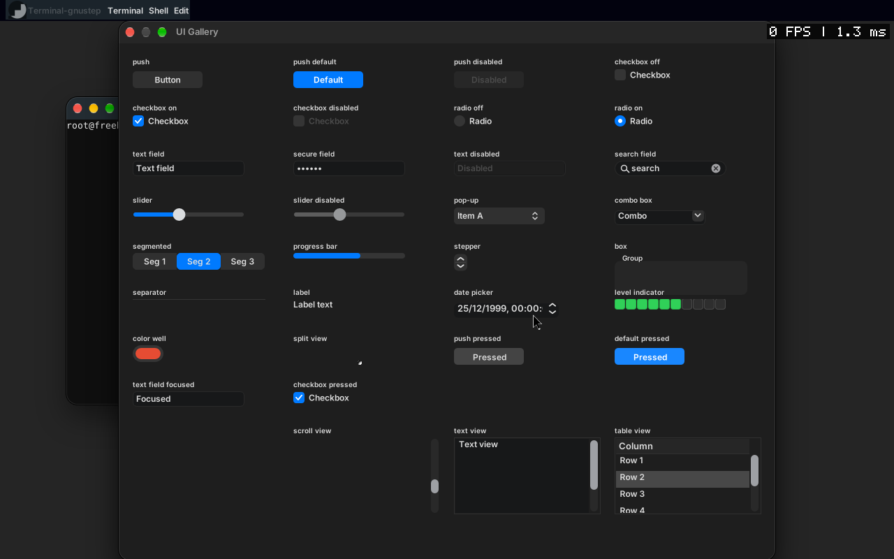
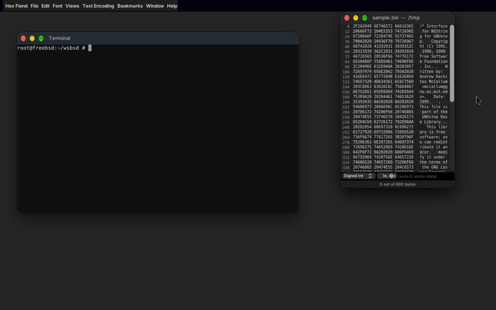
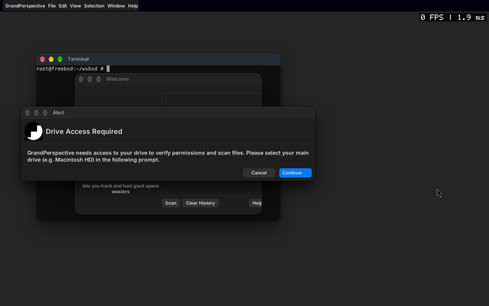
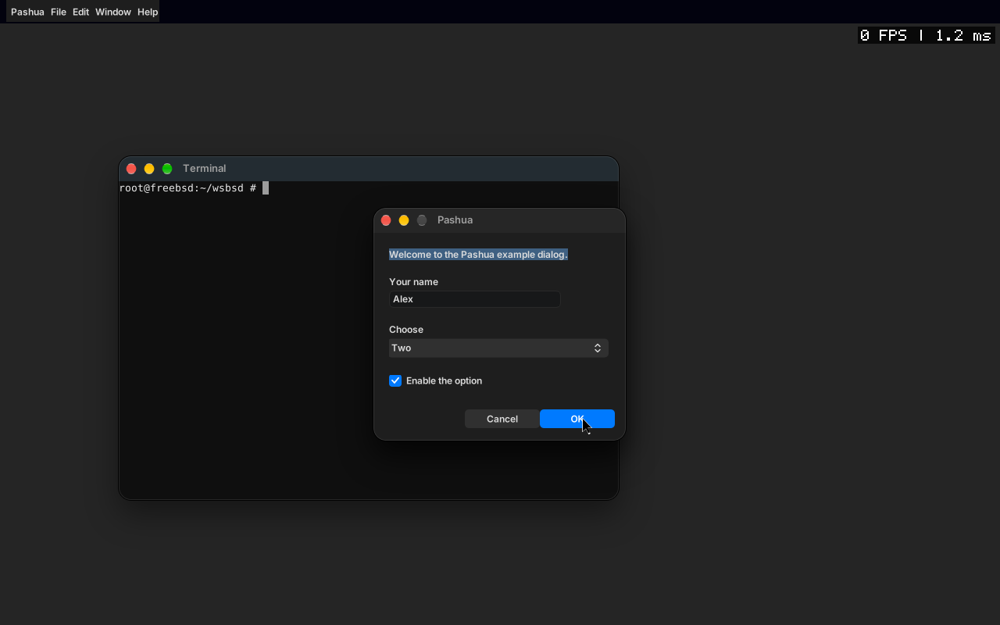
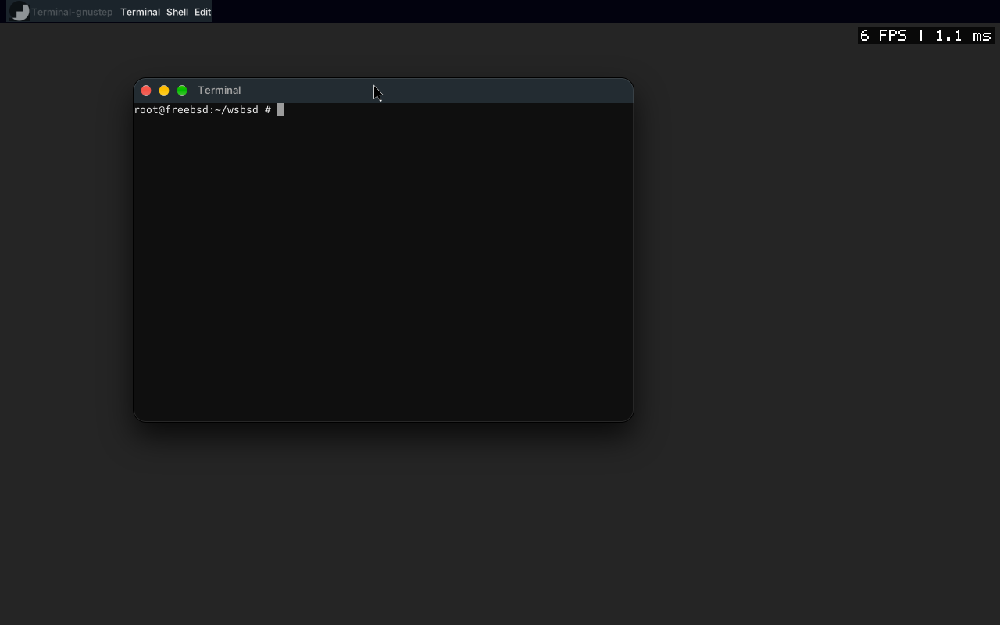
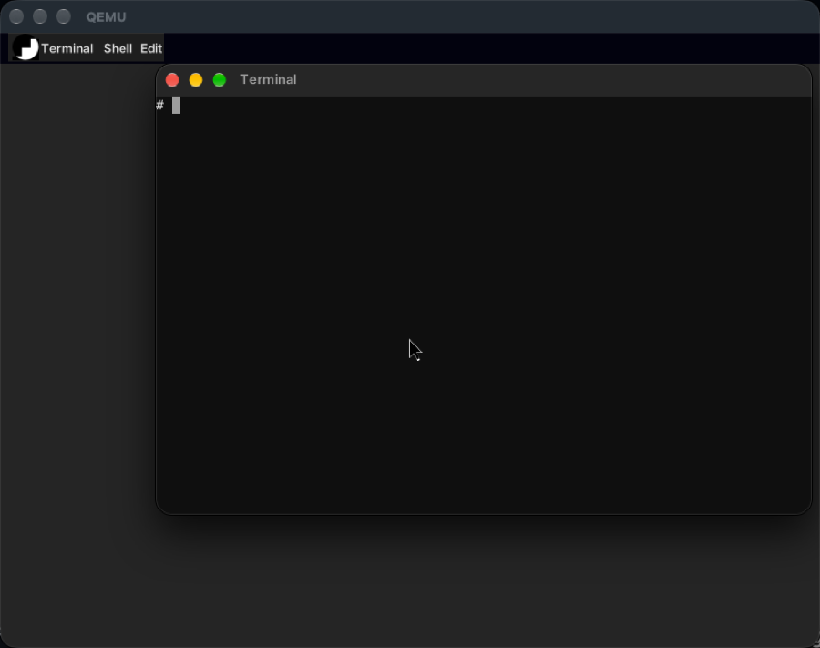
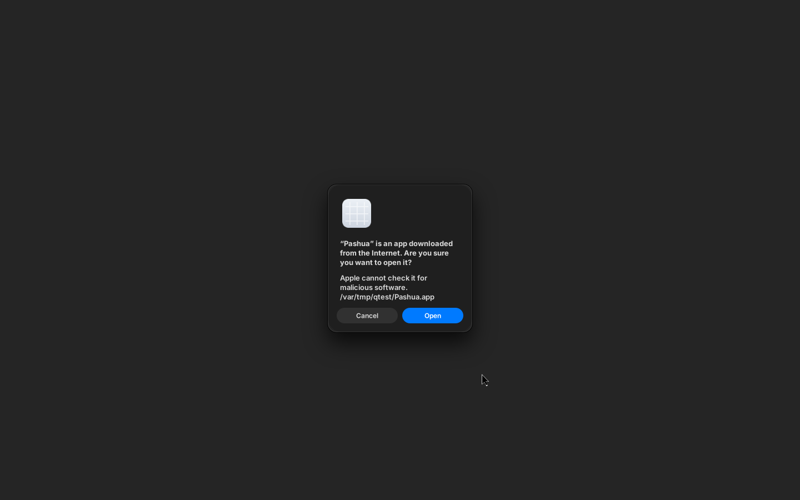

# wsbsd: a macOS-style desktop for FreeBSD

Compile **unmodified open source macOS (Cocoa / AppKit) applications from GitHub** on FreeBSD and run them on a window server that speaks the message layout of macOS's
WindowServer (SkyLight), looking like they do on a Mac. No X11, no Wayland, no Apple binaries.

| | |
|---|---|
|  |  |
| The UI gallery (33 controls) in dark appearance, drawn by GNUstep AppKit on `wsd` with the macOS theme. | [Hex Fiend](https://github.com/HexFiend/HexFiend), built from its own Xcode project, with the hex and ASCII columns. |
|  |  |
| [GrandPerspective](https://github.com/mfcarroll/grandperspective) (2026 sources, 138 files, unmodified): welcome window and its "Drive Access Required" alert. | [Pashua](https://github.com/BlueM/Pashua), 41 of 41 files built unmodified; the dialog is built from a config file (the text in it is the config's, not Pashua's) and prints its results. |

## What is in the repository

| Directory | What it is |
|---|---|
| `wsbsd/` | **The project.** `wsd` (window server and compositor, C99), the client library, the GNUstep backend, the SDK compatibility layer, the Xcode project builder, tests, docs, CI scripts |
| `wsbsd/src`, `include` | wsd: SkyLight wire protocol (about 270 of 728 routines with real handlers), software and OpenGL ES compositor, shadows, blur and vibrancy, cursor shapes, input (evdev, xkbcommon), VNC, DRM/KMS |
| `wsbsd/appkit/back-wsd` | the GNUstep display backend for wsd (`WsdServer.m`), the macOS look (`WsdMacTheme.m`), the Core Graphics bridge to Opal (`WsdCGBridge.m`) |
| `wsbsd/sdk` | **the compatibility layer**: headers and a shared library (`libwsbsdcompat`) that give GNUstep the AppKit / Foundation / CoreServices API that modern Mac sources expect, without touching the application |
| `wsbsd/tools/xcb` | a small Xcode build driver: reads `.xcodeproj`, compiles with the target's settings, links, makes a `.app` bundle |
| `wsbsd/ports/<app>/overlay` | the only place where something has to be added beside an app's sources (files that cannot compile at all, e.g. Swift) |
| `uitest/`, `ksa/`, `terminal/` | the UI gallery, a Keyboard Setup Assistant clone and a Terminal, used to compare the look with a real Mac |

## How an unmodified Mac app gets here

```
 app sources (GitHub, untouched)         wsbsd/sdk (added beside them)
   *.m  *.xib  *.pbxproj                   headers: Carbon, Security, Quartz, QuartzCore, CoreServices.FileManager, AvailabilityMacros ...
        |                                  libwsbsdcompat: AppKit/Foundation gaps, FSRef over POSIX, CoreText over Opal, UTType, xattr ...
        v                                              |
   xcb (tools/xcb): xcodeproj -> clang flags, header map, modules, prefix header, MIG  <--+
        |
        v
   NAME.app  (ELF + lib/ + Resources/ + Info-gnustep.plist)  ->  GNUstep gui/base  ->  Opal (Core Graphics on cairo)
                                                                         |
                                                                         v
                                              GNUstep backend "wsd"  --SkyLight wire protocol-->  wsd (window server)
                                                                                                      |  software / GL compositor
                                                                                                      v   VNC  |  DRM/KMS + evdev
```

Rule of the project: upstream sources are never edited. What the platform lacks is added to the SDK layer (`wsbsd/sdk`); what cannot compile (Swift) is ported to an overlay
(`wsbsd/ports/<app>/overlay`) and listed as such. Swift on FreeBSD has no Objective-C interoperability, so Swift classes that subclass `NSObject` or use AppKit cannot be built.

## Applications

State on 2026-10-17, FreeBSD 14.5 aarch64 (QEMU, HVF; a real screen in the QEMU window and VNC) and the CI virtual machine (x86_64). "Unmodified" means no line of the application's own sources was changed.

| Application | Build | Runs | Notes |
|---|---|---|---|
| [Hex Fiend](https://github.com/HexFiend/HexFiend) | framework 61 of 61, app 47 of 47 files, **unmodified** except 4 Swift files ported to Objective-C in the overlay | **yes**: menus, document windows, hex and ASCII columns with real data, themes, dark appearance, resize cursors | the window starts small; Swift-only features (some themes UI) are the overlay's |
| [GrandPerspective](https://github.com/mfcarroll/grandperspective) (2026) | 138 of 138, unmodified | **starts**: menu bar, welcome window (its right edge is clipped), its own alerts, drive access flow, folder picker | starting a scan raises an exception inside `scanFolder:filterSet:` (under investigation); no result window yet |
| [GrandPerspective 1.5](https://github.com/bezigon/GrandPerspective) (2015) | 115 of 115, unmodified | scans a folder through the Carbon File Manager shim, then **crashes**: the 2015 sources pass `float *` where AppKit takes `CGFloat *` (broken on any 64-bit platform, also on a Mac) | the 2026 sources are the target |
| [Pashua](https://github.com/BlueM/Pashua) | 41 of 41, unmodified | **yes**: reads a config file, shows the dialog (text, field, pop-up, checkbox, buttons) and prints the values on OK | the static text is drawn selected (GNUstep selects it when it gets focus) |
| Chess.app ([apple-oss-distributions/Chess](https://github.com/apple-oss-distributions/Chess)) | not started | | Swift (SharePlay), OpenGL/Metal 3D board: needs overlay for Swift and a GL path |
| [TextMate](https://github.com/textmate/textmate) | not started | | Objective-C++, its own build system (ninja + rave), many C++ dependencies |
| GNUstep Sudoku, Gorm, `terminal/`, `ksa/`, `uitest/` | yes | yes | stock GNUstep apps and the in-repo apps (CI) |

CI (`.github/workflows/wsbsd.yml`): unit and golden tests, ASan/UBSan, fuzzing, FreeBSD build of the backend with screenshots, the Hex Fiend framework build and smoke test, benchmark.

### What the compatibility layer covers today
Carbon File Manager (`FSRef`, `FSCatalogInfo`, bulk iteration) over POSIX, UTType, FSEvents (polling), xattr, DiskArbitration stubs, Security code-signing queries (answer "not available"),
CoreText drawing over Opal (glyph drawing, character sets, substitution fonts, `CGRectIntersection` semantics), NSAppearance, window / table / alert / search-field properties that GNUstep lacks,
`NSView -setFrame:` calling an application's `-setFrameSize:`, `NSWindowController -windowNibName`, Core Animation and QuickLook class stubs, and about 100 smaller things.

## The window server

- **Wire protocol**: SkyLight MIG messages over Unix sockets; layouts checked against golden vectors recorded on a real macOS; event taps (including active key taps), hotkeys, spaces, menu bar, displays.
- **Compositor**: windows with shadows (model recovered from SkyLight's shader), gaussian background blur and vibrancy, rounded and shaped windows, alpha, levels; software path and an OpenGL ES 2 path.
- **Cursor**: an independent image with a hotspot (hardware cursor plane on KMS); standard shapes drawn by the server (arrow, I-beam, hand, crosshair, resize arrows, move); AppKit cursor rects drive them, including the window edge resize cursors.
- **Input**: evdev to macOS key codes, xkbcommon layouts, pointer acceleration, wheel, tablets.
- **Frame rate counter**: `wsd -F` (or `WSD_FPS=1`) draws the system-wide frame rate and compose time in the corner; `wsfps` prints it. 
- **Displays**: the **vt(4) framebuffer** (`gmake fb`, `wsd -b kms -c /dev/ttyv0`): a real screen in the QEMU window, no VNC and no GPU driver needed, input from evdev (USB keyboard and tablet); VNC (`wsd -V 5901`; a viewer replaces a stale one, keepalive); DRM/KMS and GBM written but not yet verified on real hardware.


Standard cursor shapes as generated by the server (I-beam, hand, crosshair, the four resize arrows, open and closed hand, move).

## Performance

`test/run_bench.sh`, the same benchmark on three systems. The FreeBSD numbers come from a GitHub Actions virtual machine, the Mac numbers from an Apple M1 that is not virtualised, so only the
shape is comparable.

| | wsd on FreeBSD x86_64 (CI VM) | wsd on Apple M1 | macOS WindowServer (M1) |
|---|---|---|---|
| Round trip of a cheap request | 5.0 us (199,000 / s) | 6.6 us (151,000 / s) | 12.0 us (83,000 / s) |
| Resident size, idle | 7.1 MB | 1.9 MB | 63 MB (about 1 GB with graphics memory) |
| Resident size after 1000 connect / window / disconnect rounds | about 19.8 MB, flat | about 19 MB, flat | n/a |
| One composed 1080p frame (8 windows, shadows, blur) | 21.1 ms (software, one core) | 16.8 ms (software, one core) | on the GPU |
| CPU, idle | none measured in 3 s | none measured in 3 s | 49 to 67 % of a core |

**Frame rate, VNC against the real screen** (local FreeBSD VM: QEMU on an M1 with HVF, software compositor, one desktop with a Terminal; `wsfps`, `test`/`stress` pointer injection, measured 2026-10-17):

| Path | Frames presented per second | Per frame |
|---|---|---|
| VNC (noVNC in a browser), 1280x800 | 24 to 29 | compose 1 to 2 ms: the rate is the viewer's request cadence and the network path, not the compositor |
| **wsd on the framebuffer** (`-b kms -c /dev/ttyv0`, QEMU window, no VNC), 800x600, damage on every frame | **about 1,290** (7,010 frames in 5.4 s) | 0.66 ms compose and copy |

So without VNC the compositor is no longer the limit: it can hand the display well over 200 frames a second in this scene (a Terminal window and a moving software cursor). What a person sees is capped by the
display, QEMU's window refreshes at about 60 Hz, so the figure to quote for what is on the screen is 60; heavier scenes (several large windows with blur) compose in more time per frame and have not been
measured on the framebuffer yet.
The WindowServer's transport is Mach IPC with audit checks, wsd uses Unix sockets, so the latency comparison says little about the architecture.

UI parity with macOS (the same Objective-C gallery rendered on both, mean absolute pixel difference per control, 0 to 255): dark appearance, most controls 4 to 12, the date picker 23; light
appearance 4 to 16, the date picker 24. Much of what is left is the font (Inter, not San Francisco, which is not redistributable). Method in `wsbsd/docs/UI-MAC.md`.

## Build and run

```
cd wsbsd
gmake                 # wsd and the tools   (make on macOS)
gmake check           # the whole test suite
./wsd -g 1280x800 -V 5901 -F      # a server with a VNC viewer on 127.0.0.1:5901 and the FPS overlay
```

GNUstep backend and the compatibility layer (FreeBSD, `ci/` scripts, see `wsbsd/docs/FREEBSD.md`):

```
sh ci/gnustep-setup.sh                      # gui from source, the wsd backend, libwsclient
sh ci/opal-build.sh                         # CoreBase and Opal
sh sdk/build-compat.sh /root/compat         # libwsbsdcompat
sh ci/build-app.sh /path/App.xcodeproj Target /out/dir     # an unmodified Xcode project -> Target.app
```

## Next: a bootable ISO with the macOS file layout (`iso/`, in preparation)

A FreeBSD-based ISO that starts straight into this window server. The rules, set by the project owner:

1. **The tree is the macOS tree, with real files.** `/System`, `/System/Library/Frameworks`, `/System/Library/PrivateFrameworks`, `/System/Library/CoreServices`, `/Library`, `/Applications`, `/Users`,
   `/usr/lib`, `/private`, `/bin`, `/sbin` ... exist at the same paths as on the reference Mac (macOS 27.0, build 26A5416b), **and nothing is a symlink**: where macOS uses a symlink
   (`/etc`, `/var`, `/tmp` -> `private/...`, a framework's `Versions/Current` and its top-level `AppKit`, `Resources`, `Headers` entries) the ISO has a real directory or file.
2. **What we built is installed the way a Mac installs it.** A framework is `Name.framework/Versions/<letter>/{Name, Resources, Headers, Modules ...}` in the place the Mac has it (AppKit, Foundation,
   CoreGraphics, CoreText, QuartzCore, SkyLight ... under `/System/Library/Frameworks` or `PrivateFrameworks`), an application is `/Applications/Name.app/Contents/{MacOS,Resources,Info.plist}`,
   the dynamic linker sits at `/usr/lib/dyld` and the system libraries at `/usr/lib/` with the Mac's names. If a path exists on the Mac for a component we provide, it exists on the ISO, and the
   other way round: a file that the ISO has under a framework name must be what that framework is.
3. **Only paths and names are taken from the Mac, never content.** The manifest of the reference system (directory and file names, types, modes; no file contents) is produced by a script
   in `iso/` from the Mac the author owns; the files that fill the tree are built from this repository (our ELF libraries, GNUstep / Opal based, the apps, wsd). Apple's binaries, dyld shared cache
   and resources are not copied, and a Mach-O dyld cannot run on FreeBSD: `/usr/lib/dyld` is our own ELF loader / launcher that provides the same entry point and does the framework lookup.
4. **Boot:** UEFI (arm64 and amd64), the FreeBSD kernel, an rc script that starts `wsd` on the framebuffer (`wsd -b kms`, see `docs/FREEBSD.md`) and the login / desktop applications.
5. **Boot loader: Ploader** ([pearOS-archlinux/pearos-bootloader](https://github.com/pearOS-archlinux/pearos-bootloader), a rEFInd fork: GPL, the licence files travel with it; the binary is `ploader_x64.efi`,
   an aarch64 build is made from the same sources for the arm64 image). Nothing of FreeBSD's own boot is visible: Ploader boots the first OS silently (Alt+M picker, the recovery key combinations of that project),
   the FreeBSD `loader` is chained without its menu or logo (`beastie_disable`, `autoboot_delay` 0, `boot_mute`, `verbose_loading` off, quiet kernel and rc output), and the first thing drawn is the window server.
6. **Extended attributes work as on a Mac**, because they decide whether an application downloaded from the internet may run: `com.apple.quarantine` (flags;time;agent;UUID), `com.apple.provenance`,
   `com.apple.macl`, `com.apple.FinderInfo`, `com.apple.ResourceFork`, `com.apple.metadata:*`, `com.apple.lastuseddate#PS`, `com.apple.quarantine` removal on user approval. The root file system is UFS2 (extattr)
   or ZFS; `getxattr` / `setxattr` / `listxattr` / `removexattr` (with `XATTR_NOFOLLOW`, `XATTR_CREATE`, `XATTR_REPLACE`) map onto `extattr` in the user namespace (`sdk/src/xattr.c`); `/usr/bin/xattr`, `ls -l@`,
   `/usr/sbin/spctl` and the Launch Services check ("downloaded from the Internet. Are you sure you want to open it?", then the attribute is cleared) are part of the system; downloads written by our
   applications get the quarantine attribute. A test installs an app with and without the attribute and checks what the launcher does.

Status (2026-10-17): `wsbsd/iso/` has the manifest of the reference Mac (`manifest/`, paths only, 41,000 lines), the layout tool (`tools/macfs.py`: skeleton, install, desymlink, verify; the image has 20,365 of
the Mac's directories and no symlink), the component map (`components.json`), the silent-boot overlay, the EFI partition with Ploader, `build.sh` and `.github/workflows/iso.yml` (builds Ploader on Linux, the image
on FreeBSD amd64 and publishes the release `iso-latest`). A local arm64 build of the same script boots in QEMU straight into the window server with the Terminal, nothing of FreeBSD's boot visible:



Extended attributes and the Gatekeeper check work (tested on FreeBSD UFS, `wsbsd/iso/test/xattr-test.sh`): `xattr` and `spctl` tools, `XATTR_CREATE` / `XATTR_REPLACE`, and Launch Services asks before it opens a quarantined
application ("is an app downloaded from the Internet. Are you sure you want to open it?"); after Open the attribute carries the approved flag (`0083` becomes `00c3`) and the question is not asked again:



What is not done yet: the framework files are our libraries under the Mac's names, the other 360 or so frameworks are directories with an `Info.plist` and no library; Hex Fiend and the other apps are not on the image
yet; the amd64 image is built by CI (first result pending), the arm64 image has no Ploader (it boots through FreeBSD's loader directly).

## Known limits
- DRM/KMS, evdev and the GL compositor have not been run on real hardware (CI has no GPU).
- The font is Inter; window layout of some apps (Pashua's dialog) and several AppKit behaviours differ from macOS.
- Swift code cannot be compiled (no Objective-C interoperability in Swift on FreeBSD); UIKit is out of scope; SwiftUI is a later target.
- Core Animation layers, WebKit and Metal are not provided; stubs only where an app merely references them.

## Provenance
The protocol facts were obtained by analysing a macOS installation the author owns (decompilation with Ghidra through REA, and black-box probing of public and private APIs on the running system)
for the purpose of interoperability. No Apple code is included; the implementation is original. The raw tables of Apple routine names and addresses are not published. GNUstep and Opal are
used as libraries (LGPL). Anyone redistributing or building on this should check the licence terms that apply to them.
